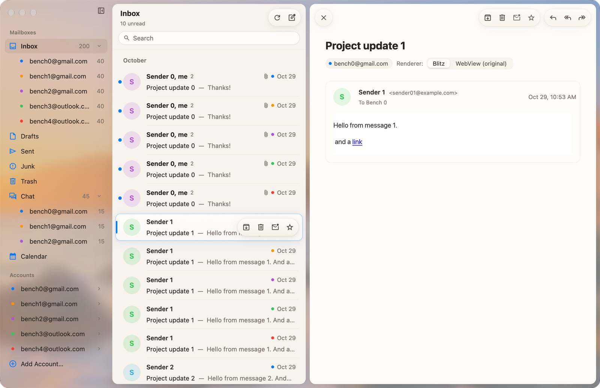

<p align="center">
  
</p>

<h1 align="center">Mailstream</h1>

<p align="center">
  <strong>A fast, fluid desktop email client for Gmail and Outlook, built for humans and AI agents.</strong>
</p>

<p align="center">
  <a href="#overview">Overview</a> •
  <a href="#features">Features</a> •
  <a href="#download">Download</a> •
  <a href="#quick-start">Quick Start</a> •
  <a href="#cli--agent-automation">CLI & Agents</a> •
  <a href="#architecture">Architecture</a> •
  <a href="#first-time-setup">OAuth & Push Setup</a>
</p>

---

## Overview

Mailstream is a modern, keyboard-first desktop mail client engineered for speed, privacy, and programmable automation. It connects directly from your Mac or PC to Google and Microsoft APIs over HTTPS—no proprietary sync servers, no third-party proxies, and zero external access to your email data.

Designed after macOS Liquid Glass with Dia's floating islands, Mailstream delivers a native 120 FPS experience powered by a multithreaded Rust engine, local Turso SQLite storage, and an on-device AI triage pipeline.

<p align="center">
  <picture>
    <source media="(prefers-color-scheme: dark)" srcset="docs/assets/mailstream-gpui-dark.png">
    
  </picture>
</p>

---

## Features

### ⚡ 120 FPS Native Desktop Performance
- **ProMotion Smoothness**: Every animation and list transition runs at 120 Hz with hardware-accelerated rendering and zero frame drops.
- **Instant Local Cache**: Backed by [Turso SQLite](https://github.com/tursodatabase/turso) with multi-process WAL (`mail.db`). App launch paints immediately from disk before hitting the network.
- **Pre-warmed Reader**: Conversation bodies load asynchronously when hovering or focusing list rows, rendering instantly upon opening.

### 🔒 Zero Middleman, True Direct Privacy
- **Direct-to-Provider**: Communicates directly with the Gmail API, Microsoft Graph, and Google Chat API over encrypted HTTPS from your device.
- **Local Credentials**: Refresh tokens are sealed directly in your macOS Keychain or Windows DPAPI (on Linux, a file only you can read in `~/.local/share/Mailstream`). No central server ever sees your tokens, passwords, or emails.
- **Strict Content Sandboxing**: Remote images are blocked by default for untrusted senders, and message bodies are isolated in sandboxed iframes with page scripts disabled.

### 🧠 Smart Inbox & On-Device AI Triage
- **Automatic Categorization**: Organizes inbound mail into **Notifications**, **Newsletters**, and **Invitations** tiles without cluttering your personal correspondence.
- **"Waiting on you" Detection**: Automatically highlights messages requiring your reply, action, approval, or RSVP under a dedicated triage header.
- **100% On-Device AI**: Powered by Apple Intelligence on macOS (`aiTagging.backend apple`) or local LLMs via `omp`. Your message bodies never leave your machine for categorization.
- **Auto-Read for Stale Alerts**: Optionally auto-marks outdated marketing newsletters and resolved notification badges as read.
- **Tags Synced Across Devices**: Every Gmail and Outlook account's tags sync both ways with the server unless switched off per account (`aiTagging.localOnlyAccounts`): as Gmail labels or Outlook categories named People, Notifications, Newsletters, Invitations and Waiting on you, and topic labels as `Mailstream/<topic>` (nested under Mailstream in Gmail). So Mailstream on your other devices shows the same tags, mail one device tagged isn't tagged again on another, and the tags show in Gmail and Outlook too. Labels are never deleted.

### 💬 Unified Communication: Chat & Calendar
- **Google Chat**: Integrated Google Workspace Chat spaces and direct messages directly in your sidebar, complete with real-time updates and threaded replies.
- **Multi-Account Calendar**: View your schedule across all connected Google and Outlook accounts as an agenda or as day and week timelines (all-day row; meetings as quiet cards with their calendar's dot, the call and the guests; clashes, unanswered invitations and declined or finished meetings marked at a glance; today's date and column lit; the current time in the margin), page through days and weeks, inspect event details, and join Google Meet or Microsoft Teams calls in one click.
- **Event Editing**: Add events (title, time or all day, place, guests, description) to any calendar you can write to, and change or delete the ones you organize; Google Calendar and Outlook tell the guests.
- **Interactive Meeting Invitations**: RSVP to calendar invitations (Accept, Tentative, Decline) directly from email headers with instant calendar sync.

### 🤖 Agent-First & Fully Programmable
- **Native CLI (`mailstream`)**: Every action the app can perform—listing, searching, viewing, tagging, archiving, drafting, and sending—can be run from the terminal or invoked by background scripts.
- **Structured JSON Protocol**: Interacts over a lightweight local Unix domain socket (`control.sock`) or Windows named pipe. Perfect for integration with autonomous coding and productivity agents.

### ⌨️ Keyboard-Centric Productivity
- Single-key triage shortcuts: `e` (archive), `⌫` (trash), `u` (toggle read), `s` (star), `r` (reply), `a` (reply all), `f` (forward).
- Instant multi-account search (`⌘F`) matching across local cache and server bodies.
- Two-finger trackpad back-swipe and `Esc` navigation.

---

## Download

| Platform | Target | Requirements |
| :--- | :--- | :--- |
| **macOS** | `Mailstream GPUI.app` | macOS 26 or later (Apple Silicon) |
| **Linux** | `mailstream-gpui` | Build from source: see `GPUI/README.md` |

The Flutter front end (`Flutter/`, the only one on Windows) is paused (MS-300): it stays in the repository, but CI no longer builds or publishes it, and its signed updates have stopped.

Pre-built binaries are generated on every push to `main` via GitHub Actions (`.github/workflows/build.yml`). You can download the latest nightly disk images (`Mailstream-GPUI.dmg`, `Mailstream.dmg`) from the repository's Actions artifacts or Releases.

> **macOS Note**: When downloading ad-hoc signed nightly builds, remove the quarantine flag prior to first launch:
> ```sh
> xattr -dr com.apple.quarantine "/Applications/Mailstream GPUI.app"
> ```

---

## Quick Start

1. **Launch the App**: Open Mailstream. On first launch with no accounts configured, the **Settings** window opens automatically.
2. **Add Your Accounts**:
   - Go to **Mailstream ▸ Settings…** (`⌘,`) ▸ **Add Google Account…** or **Add Microsoft Account…**.
   - Complete OAuth authorization in your default browser.
   - Tokens are automatically saved to your system keychain.
3. **Sync**:
   - Mailstream fetches your recent inbox envelopes and caches them locally in `~/Library/Application Support/Mailstream/mail.db`.
   - Subsequent launches open instantly from local cache.

---

## CLI & Agent Automation

Mailstream is designed from the ground up to be inspected and driven by developer tools and AI agents. Link the bundled CLI binary into your path (on macOS; `scripts/install.sh gpui` on Linux links `~/.local/opt/mailstream-gpui/mailstream` automatically):

```sh
ln -s '/Applications/Mailstream GPUI.app/Contents/MacOS/mailstream' ~/.local/bin/mailstream
```

### Essential CLI Commands

```sh
# App status and sync health
mailstream status

# List recent unread inbox messages
mailstream mail list --mailbox inbox --unread --limit 10

# Search messages across accounts
mailstream mail search "invoice" --account you@gmail.com

# Fetch conversation detail (with HTML bodies and cached inline images)
mailstream mail show '<conversation-id>' --html

# Triage actions
mailstream mail archive '<id>'
mailstream mail star '<id>'
mailstream mail tag '<id>' --category newsletter
mailstream mail tag '<id>' '<id2>' --add-labels Finance --remove-labels Travel

# Send replies (requires --yes confirmation)
mailstream mail reply '<id>' --body "Thanks, received!" --yes

# Google Chat operations
mailstream chat spaces
mailstream chat messages you@gmail.com spaces/AAAA
mailstream chat send you@gmail.com spaces/AAAA --text "On my way" --yes

# Calendar agenda (with every calendar in each account's list: its own, and others' shared with
# it or subscribed to), showing or hiding one, adding someone's shared Google calendar to the list
# or removing one, and adding, changing and deleting your own events
mailstream calendar events --days 7
mailstream calendar show you@gmail.com --calendar colleague@example.com
mailstream calendar show you@gmail.com --calendar colleague@example.com --off
mailstream calendar add you@gmail.com --calendar colleague@example.com
mailstream calendar remove you@gmail.com --calendar colleague@example.com --yes
mailstream calendar create you@gmail.com --title "Lunch" --start 2026-11-10T12:00 --location "Cafe"
mailstream calendar update you@gmail.com --calendar you@gmail.com --id <event id> --title "Team lunch"
mailstream calendar delete you@gmail.com --calendar you@gmail.com --id <event id> --yes
```

### Headless Engine Daemon (Linux Servers)

The same standalone `mailstream` binary runs Mailstream's whole engine without a GUI, so a server (and the AI agents on it) can use every command: `status`, `accounts`, `mailboxes`, `mail`, `calendar`, `chat`, `config` and `sync`. It keeps the signed-in accounts' mail, calendars and Google Chat in sync and answers on the control socket of its data directory:

```sh
mailstream daemon --data-dir /var/lib/mailstream     # or $MAILSTREAM_DATA_DIR; prints JSON lines

# In another shell: give every command the same data directory
export MAILSTREAM_DATA_DIR=/var/lib/mailstream
mailstream accounts add google --client-id <id> --client-secret <secret>
mailstream mail list --unread --limit 10
mailstream calendar events --days 7
```

The data directory holds everything: `settings.json`, `accounts.json`, `mail.db`, `peer-sync/`, the sign-ins file (`dev.mailstream.Mailstream.oauth.signins`, mode `0600`), `cache/` and `control.sock`. Only one Mailstream (the daemon or the app) serves a data directory; a second daemon there exits with `busy`. Without a running daemon, commands for another data directory, or on a machine without a desktop session, fail at once with `not_running` and name the `mailstream daemon` command to start, instead of launching Mailstream GPUI.

Signing in: `accounts add` and `accounts connect` print the provider's sign-in page in the daemon's output as a `{"event":"signIn","url":…}` line (and open it in a browser only on a desktop). The page returns to `http://localhost:49152` on the server, so open it from a machine that forwards that port: `ssh -L 49152:localhost:49152 <server>`. `--join <ticket>` and `--cloud <url>` work as for `mailstream sync daemon` below. A `systemd` unit is the one below with `ExecStart=/usr/local/bin/mailstream daemon --data-dir /var/lib/mailstream` and `StateDirectory=mailstream`.

### Headless Sync Daemon (Linux Servers)

The standalone `mailstream` binary from GitHub Releases (`mailstream-linux-x86_64.tar.gz` / `mailstream-linux-aarch64.tar.gz`) can run as an always-on `iroh` sync node on a server without a GUI, mail accounts, OAuth tokens, or Keychain/Secret Service:

```sh
# First run: join an existing sync group using a ticket from your desktop app (`mailstream sync pair-ticket`)
mailstream sync daemon --data-dir /var/lib/mailstream-sync --join '<DocTicket>'

# Subsequent runs / systemd service: reuse persisted keys and state in `--data-dir` (or `$MAILSTREAM_DATA_DIR`)
mailstream sync daemon --data-dir /var/lib/mailstream-sync

# Inspect node status or mint a pairing ticket for a new laptop
mailstream sync status --data-dir /var/lib/mailstream-sync
mailstream sync pair-ticket --data-dir /var/lib/mailstream-sync
```

Devices sync only with the devices the group admitted (MS-380), so knowing the group id that `sync status` shows reads nothing. A device that joins with a ticket is admitted by a device of the group it reaches (keep the device that made the ticket online for the first join); until then it keeps asking. Devices paired before this admit each other by themselves after updating.

Mail bodies between devices (MS-394, MS-400): before spending Gmail or Outlook REST API quota on a message's body and attachments, a device checks already-connected low-latency direct peers (`mailstream/mail/1`, admitted devices only), then Gmail IMAP (`BODY.PEEK[]` on All Mail when configured), then remaining peers (relayed, or newly dialed in the background), and falls back to the provider REST API when none answers. Opening a message asks only already-connected peers (capping relayed peers at 300 ms RTT and waiting up to half a second); loading list previews may dial unconnected peers in the fallback step and wait a few seconds. It asks only for messages the provider just listed, and labels, read state and deletions still come from the provider alone; mail never enters the group's document or the Cloudflare fallback. A `mailstream daemon` that stays online serves the most; the light `mailstream sync daemon` holds no mail. `sync status` counts the bodies taken this way (`mail.messages`) and about how many Gmail quota units they saved (`mail.gmailUnits`).

Example `systemd` unit (`/etc/systemd/system/mailstream-sync.service`):

```ini
[Unit]
Description=Mailstream Headless Settings Sync Daemon
After=network-online.target
Wants=network-online.target

[Service]
Type=simple
DynamicUser=yes
StateDirectory=mailstream-sync
StateDirectoryMode=0700
ExecStart=/usr/local/bin/mailstream sync daemon --data-dir /var/lib/mailstream-sync
Restart=on-failure
RestartSec=5

[Install]
WantedBy=multi-user.target
```

### Cloudflare Fallback for Device Sync (optional)

Without an always-on node, a change reaches another device only once both are online at the same time. The optional Cloudflare fallback (`SyncDrop/`, MS-374) closes that gap on the Workers Free plan: each device keeps an encrypted copy of the synced settings (trusted senders with their removals, the synced settings, the device list) on your own Worker and merges the other devices' copies, latest change per key winning. The Worker stores only AES-256-GCM ciphertext under ids derived from the sync group's secret, and only the group's devices can read or replace its copies (the group's first upload registers a write token derived from the same secret). It is off until you turn it on.

Deploy the Worker once with your Cloudflare account (free; one SQLite Durable Object per sync group):

```sh
cd SyncDrop
npx --yes wrangler@4 login     # opens Cloudflare in the browser
npx --yes wrangler@4 deploy    # prints https://mailstream-sync-drop.<you>.workers.dev
```

Then turn it on on each device with that URL: Settings ▸ Device sync ▸ Cloudflare fallback, or

```sh
mailstream sync cloud-enable https://mailstream-sync-drop.<you>.workers.dev
mailstream sync daemon --data-dir /var/lib/mailstream-sync --cloud https://mailstream-sync-drop.<you>.workers.dev
mailstream sync cloud-disable   # stops it and deletes this device's copy from the Worker
```

Devices exchange with the Worker after every change, on start, after waking or a network change, and every 5 minutes. `npx wrangler@4 dev` in a copy of `SyncDrop/` runs the same Worker locally (no account), for `mailstream sync cloud-enable http://127.0.0.1:8787`.

### Protocol Details
Commands communicate over a local Unix domain socket at `~/Library/Application Support/Mailstream/control.sock` (mode `0600`) using single-line JSON messages:
```json
{"command": "mail.list", "args": {"unread": true}}
```
Response:
```json
{"ok": true, "result": { ... }}
```

---

## Architecture

Mailstream decouples front-end presentation from core email synchronisation and protocol logic:

```
┌────────────────────────────────────────────────────────┐
│                   Desktop Front Ends                   │
│    GPUI (Primary)    │  Flutter (paused)   │   AppKit  │
└───────────────────────────┬────────────────────────────┘
                            │ UniFFI / FFI Layer
┌───────────────────────────▼────────────────────────────┐
│                   Rust Engine (Engine/)                │
│   • Tokio Runtime        • Multi-Account Sync Scheduler│
│   • MIME Parser/Writer   • SQLite Cache (Turso C API)  │
│   • Control Socket (IPC) • Apple Intelligence / OMP    │
└───────────────────────────┬────────────────────────────┘
                            │ HTTPS / WebSockets
┌───────────────────────────▼────────────────────────────┐
│      Gmail API  •  Microsoft Graph  •  Google Chat     │
└────────────────────────────────────────────────────────┘
```

| Layer | Key Components | Role |
| :--- | :--- | :--- |
| **Flutter UI** (paused, MS-300) | `Flutter/lib/` | High-performance desktop UI featuring macOS Liquid Glass styling, multi-column navigation, Dia's floating islands, and an HTML reader drawn by Blitz (WebKit on its renderer switch). |
| **FFI Bridge** | `FFI/` | Rust UniFFI crate exposing typed async APIs, models, and real-time Darwin change notifications to Dart and C hosts. |
| **Rust Engine** | `Engine/` | Core business logic running on Tokio: account synchronization, Turso SQLite database management, OAuth token refresh, MIME serialization, and Unix domain socket control server. |
| **Turso DB** | `Support/SQLite.swift`, `.turso/` | Embedded Turso database engine running multi-process WAL mode (`mail.db-tshm`) for concurrent UI and background process reads. |
| **Push Relay** | `Push/` | Stateless Cloudflare Worker relay forwarding Google Pub/Sub push notifications and Microsoft Graph webhooks over a single WebSocket to the local client. |
| **Sync Drop** | `SyncDrop/` | Optional Cloudflare Worker holding device sync's encrypted settings copies for devices that are never online together. |

---

## First-Time Setup

To connect to Gmail or Outlook with production quotas and receive real-time push notifications, configure your personal OAuth applications and optional push relay:

Run the interactive setup helper:
```sh
scripts/setup.sh
```

### 1. Google Cloud Platform (Gmail & Chat)
1. Enable the **Gmail API**, **Google Pub/Sub API**, **Google Chat API**, and **People API** in your GCP Project.
2. Configure an OAuth Consent Screen and create an OAuth Client ID of type **Desktop app**.
3. Create a Pub/Sub topic named `gmail-push` for mailbox watch push events.

### 2. Microsoft Entra ID (Outlook & Microsoft 365)
1. Register an application in [Microsoft Entra ID](https://entra.microsoft.com/) supporting personal and organizational accounts.
2. Add Web redirect URI: `http://localhost:49152`.
3. Add delegated Microsoft Graph permissions: `User.Read`, `Mail.ReadWrite`, `Mail.Send`, `Contacts.Read`, and `Calendars.ReadWrite`. Signing in asks only for the mail ones; contacts and the calendar are asked for when you connect them for an account (Settings ▸ Accounts), as are Google's contacts, Chat and calendar.
4. Generate a client secret.

### 3. Push Relay (Cloudflare Worker)
Mailstream receives instant push notifications via an open-source Cloudflare Worker relay (`Push/`):
```sh
cd Push && ./deploy.sh
```
The relay receives webhook calls from Gmail Pub/Sub and Microsoft Graph, forwarding message change IDs to your client over WebSocket. The relay stores zero message content or authentication tokens.

*Note: If push is unconfigured, Mailstream falls back to intelligent background polling (`sync.pollSeconds`, default 90s).*

---

## Building from Source

### Prerequisites
- **macOS**: macOS 26+, Xcode Command Line Tools, Flutter 3.x, Rust (cargo), Python 3.
- **Windows**: Windows 11/10 x64, Visual Studio 2022 (C++ desktop workload), Flutter, Rust.
- **Linux**: Flutter, Rust (rustup), clang/libclang, CMake, Ninja, pkg-config, and GTK 3, GLib and fontconfig development files (`devenv shell` provides all but Rust). Build steps: `Flutter/README.md` ▸ Linux. The GPUI front end also needs Wayland or X11 (xcb), xkbcommon and the Vulkan loader, which `devenv shell` provides too: `devenv shell -- GPUI/run.sh` (`GPUI/README.md`).

### Build Steps (macOS Flutter, paused)

Flutter is paused (MS-300): these steps are kept for when it resumes; engine changes no longer keep it compiling, and `scripts/install.sh` refuses `flutter`.

```sh
# 1. Build the Turso embedded SQLite library (first-time only)
./scripts/turso.sh

# 2. Build the Rust FFI engine and generate Dart bindings
CONFIG=release DART_OUT=$PWD/Flutter/packages/mailstream/lib/src python3 scripts/ffi.py

# 3. Build and sign the Flutter desktop application
cd Flutter
flutter build macos --release
../scripts/sign.sh "build/macos/Build/Products/Release/Mailstream Flutter.app"
```

To install the GPUI front end directly to `/Applications` (`GPUI/README.md`):
```sh
./scripts/install.sh gpui
```

---

## Keyboard Shortcuts

| Shortcut | Context | Action |
| :--- | :--- | :--- |
| `Return` / `Space` | List | Open selected conversation or bundle |
| `Esc` / `⌘[` | Reader / Bundle | Back to conversation list |
| `e` / `⌃⌘A` | List / Reader | Archive conversation |
| `⌫` / `⌘⌫` | List / Reader | Move to Trash |
| `u` / `⇧⌘U` | List / Reader | Toggle Read / Unread |
| `s` / `⇧⌘L` | List / Reader | Toggle Star |
| `r` / `⌘R` | Reader | Reply to conversation |
| `a` / `⇧⌘R` | Reader | Reply All |
| `f` / `⇧⌘F` | Reader | Forward conversation |
| `⌘↩` | Composer | Send message |
| `⌘N` | Global | New message |
| `⌥⌘N` | Global | New Google Chat space |
| `⌘F` | Global | Focus search bar |
| `⌘,` | Global | Preferences / Settings |
| `a` / `d` / `w` | Calendar | Agenda, day or week view |
| `t` | Calendar | Today |
| `←` `→` / `k` `j` / `p` `n` | Calendar (day, week) | Previous / next day or week |

---

## License

Mailstream is open-source software licensed under the MIT License.
