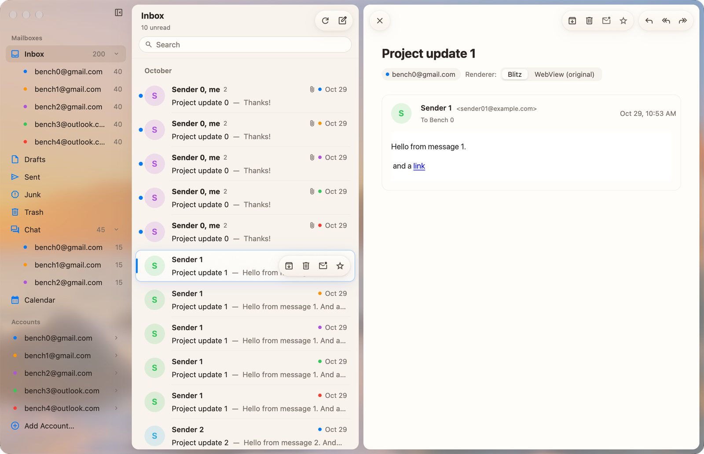

<p align="center">
  
</p>

<h1 align="center">Mailstream</h1>

<p align="center">
  <strong>A fast, fluid desktop email client for Gmail and Outlook, built for humans and AI agents.</strong>
</p>

<p align="center">
  <a href="#overview">Overview</a> •
  <a href="#features">Features</a> •
  <a href="#download">Download</a> •
  <a href="#quick-start">Quick Start</a> •
  <a href="#cli--agent-automation">CLI & Agents</a> •
  <a href="#architecture">Architecture</a> •
  <a href="#first-time-setup">OAuth & Push Setup</a>
</p>

---

## Overview

Mailstream is a modern, keyboard-first desktop mail client engineered for speed, privacy, and programmable automation. It connects directly from your Mac or PC to Google and Microsoft APIs over HTTPS—no proprietary sync servers, no third-party proxies, and zero external access to your email data.

Designed after macOS Liquid Glass with Dia's floating islands, Mailstream delivers a native 120 FPS experience powered by a multithreaded Rust engine, local Turso SQLite storage, and an on-device AI triage pipeline.

<p align="center">
  <picture>
    <source media="(prefers-color-scheme: dark)" srcset="docs/assets/mailstream-gpui-dark.png">
    
  </picture>
</p>

---

## Features

### ⚡ 120 FPS Native Desktop Performance
- **ProMotion Smoothness**: Every animation and list transition runs at 120 Hz with hardware-accelerated rendering and zero frame drops.
- **Instant Local Cache**: Backed by [Turso SQLite](https://github.com/tursodatabase/turso) with multi-process WAL (`mail.db`). App launch paints immediately from disk before hitting the network.
- **Pre-warmed Reader**: Conversation bodies load asynchronously when hovering or focusing list rows, rendering instantly upon opening.

### 🔒 Zero Middleman, True Direct Privacy
- **Direct-to-Provider**: Communicates directly with the Gmail API, Microsoft Graph, and Google Chat API over encrypted HTTPS from your device.
- **Local Credentials**: Refresh tokens are sealed directly in your macOS Keychain or Windows DPAPI (on Linux, a file only you can read in `~/.local/share/Mailstream`). No central server ever sees your tokens, passwords, or emails.
- **Strict Content Sandboxing**: Remote images are blocked by default for untrusted senders, and message bodies are isolated in sandboxed iframes with page scripts disabled.

### 🧠 Smart Inbox & On-Device AI Triage
- **Automatic Categorization**: Organizes inbound mail into **Notifications**, **Newsletters**, and **Invitations** tiles without cluttering your personal correspondence.
- **"Waiting on you" Detection**: Automatically highlights messages requiring your reply, action, approval, or RSVP under a dedicated triage header.
- **100% On-Device AI**: Powered by Apple Intelligence on macOS (`aiTagging.backend apple`) or local LLMs via `omp`. Your message bodies never leave your machine for categorization.
- **Auto-Read for Stale Alerts**: Optionally auto-marks outdated marketing newsletters and resolved notification badges as read.
- **Tags Synced as Labels**: Optionally, per account (`aiTagging.syncAccounts`), tags sync both ways with Gmail labels or Outlook categories of the same name (People, Notifications, Newsletters, Invitations, Waiting on you), so they show in Gmail and Outlook and mail one device tagged isn't tagged again on another. Labels are never deleted.

### 💬 Unified Communication: Chat & Calendar
- **Google Chat**: Integrated Google Workspace Chat spaces and direct messages directly in your sidebar, complete with real-time updates and threaded replies.
- **Multi-Account Calendar**: View your schedule across all connected Google and Outlook accounts as an agenda or as day and week timelines (all-day row; meetings as quiet cards with their calendar's dot, the call and the guests; clashes, unanswered invitations and declined or finished meetings marked at a glance; today's date and column lit; the current time in the margin), page through days and weeks, inspect event details, and join Google Meet or Microsoft Teams calls in one click.
- **Event Editing**: Add events (title, time or all day, place, guests, description) to any calendar you can write to, and change or delete the ones you organize; Google Calendar and Outlook tell the guests.
- **Interactive Meeting Invitations**: RSVP to calendar invitations (Accept, Tentative, Decline) directly from email headers with instant calendar sync.

### 🤖 Agent-First & Fully Programmable
- **Native CLI (`mailstream`)**: Every action the app can perform—listing, searching, viewing, tagging, archiving, drafting, and sending—can be run from the terminal or invoked by background scripts.
- **Structured JSON Protocol**: Interacts over a lightweight local Unix domain socket (`control.sock`) or Windows named pipe. Perfect for integration with autonomous coding and productivity agents.

### ⌨️ Keyboard-Centric Productivity
- Single-key triage shortcuts: `e` (archive), `⌫` (trash), `u` (toggle read), `s` (star), `r` (reply), `a` (reply all), `f` (forward).
- Instant multi-account search (`⌘F`) matching across local cache and server bodies.
- Two-finger trackpad back-swipe and `Esc` navigation.

---

## Download

| Platform | Target | Requirements |
| :--- | :--- | :--- |
| **macOS** | `Mailstream GPUI.app` | macOS 26 or later (Apple Silicon) |
| **Linux** | `mailstream-gpui` | Build from source: see `GPUI/README.md` |

The Flutter front end (`Flutter/`, the only one on Windows) is paused (MS-300): it stays in the repository, but CI no longer builds or publishes it, and its signed updates have stopped.

Pre-built binaries are generated on every push to `main` via GitHub Actions (`.github/workflows/build.yml`). You can download the latest nightly disk images (`Mailstream-GPUI.dmg`, `Mailstream.dmg`) from the repository's Actions artifacts or Releases.

> **macOS Note**: When downloading ad-hoc signed nightly builds, remove the quarantine flag prior to first launch:
> ```sh
> xattr -dr com.apple.quarantine "/Applications/Mailstream GPUI.app"
> ```

---

## Quick Start

1. **Launch the App**: Open Mailstream. On first launch with no accounts configured, the **Settings** window opens automatically.
2. **Add Your Accounts**:
   - Go to **Mailstream ▸ Settings…** (`⌘,`) ▸ **Add Google Account…** or **Add Microsoft Account…**.
   - Complete OAuth authorization in your default browser.
   - Tokens are automatically saved to your system keychain.
3. **Sync**:
   - Mailstream fetches your recent inbox envelopes and caches them locally in `~/Library/Application Support/Mailstream/mail.db`.
   - Subsequent launches open instantly from local cache.

---

## CLI & Agent Automation

Mailstream is designed from the ground up to be inspected and driven by developer tools and AI agents. Link the bundled CLI binary into your path:

```sh
ln -s '/Applications/Mailstream Flutter.app/Contents/MacOS/mailstream' ~/.local/bin/mailstream
```

### Essential CLI Commands

```sh
# App status and sync health
mailstream status

# List recent unread inbox messages
mailstream mail list --mailbox inbox --unread --limit 10

# Search messages across accounts
mailstream mail search "invoice" --account you@gmail.com

# Fetch conversation detail (with HTML bodies and cached inline images)
mailstream mail show '<conversation-id>' --html

# Triage actions
mailstream mail archive '<id>'
mailstream mail star '<id>'
mailstream mail tag '<id>' --category newsletter

# Send replies (requires --yes confirmation)
mailstream mail reply '<id>' --body "Thanks, received!" --yes

# Google Chat operations
mailstream chat spaces
mailstream chat messages you@gmail.com spaces/AAAA
mailstream chat send you@gmail.com spaces/AAAA --text "On my way" --yes

# Calendar agenda (with every calendar in each account's list: its own, and others' shared with
# it or subscribed to), showing or hiding one, and adding, changing and deleting your own events
mailstream calendar events --days 7
mailstream calendar show you@gmail.com --calendar colleague@example.com
mailstream calendar show you@gmail.com --calendar colleague@example.com --off
mailstream calendar create you@gmail.com --title "Lunch" --start 2026-11-10T12:00 --location "Cafe"
mailstream calendar update you@gmail.com --calendar you@gmail.com --id <event id> --title "Team lunch"
mailstream calendar delete you@gmail.com --calendar you@gmail.com --id <event id> --yes
```

### Protocol Details
Commands communicate over a local Unix domain socket at `~/Library/Application Support/Mailstream/control.sock` (mode `0600`) using single-line JSON messages:
```json
{"command": "mail.list", "args": {"unread": true}}
```
Response:
```json
{"ok": true, "result": { ... }}
```

---

## Architecture

Mailstream decouples front-end presentation from core email synchronisation and protocol logic:

```
┌────────────────────────────────────────────────────────┐
│                   Desktop Front Ends                   │
│    GPUI (Primary)    │  Flutter (paused)   │   AppKit  │
└───────────────────────────┬────────────────────────────┘
                            │ UniFFI / FFI Layer
┌───────────────────────────▼────────────────────────────┐
│                   Rust Engine (Engine/)                │
│   • Tokio Runtime        • Multi-Account Sync Scheduler│
│   • MIME Parser/Writer   • SQLite Cache (Turso C API)  │
│   • Control Socket (IPC) • Apple Intelligence / OMP    │
└───────────────────────────┬────────────────────────────┘
                            │ HTTPS / WebSockets
┌───────────────────────────▼────────────────────────────┐
│      Gmail API  •  Microsoft Graph  •  Google Chat     │
└────────────────────────────────────────────────────────┘
```

| Layer | Key Components | Role |
| :--- | :--- | :--- |
| **Flutter UI** (paused, MS-300) | `Flutter/lib/` | High-performance desktop UI featuring macOS Liquid Glass styling, multi-column navigation, Dia's floating islands, and an HTML reader drawn by Blitz (WebKit on its renderer switch). |
| **FFI Bridge** | `FFI/` | Rust UniFFI crate exposing typed async APIs, models, and real-time Darwin change notifications to Dart and C hosts. |
| **Rust Engine** | `Engine/` | Core business logic running on Tokio: account synchronization, Turso SQLite database management, OAuth token refresh, MIME serialization, and Unix domain socket control server. |
| **Turso DB** | `Support/SQLite.swift`, `.turso/` | Embedded Turso database engine running multi-process WAL mode (`mail.db-tshm`) for concurrent UI and background process reads. |
| **Push Relay** | `Push/` | Stateless Cloudflare Worker relay forwarding Google Pub/Sub push notifications and Microsoft Graph webhooks over a single WebSocket to the local client. |

---

## First-Time Setup

To connect to Gmail or Outlook with production quotas and receive real-time push notifications, configure your personal OAuth applications and optional push relay:

Run the interactive setup helper:
```sh
scripts/setup.sh
```

### 1. Google Cloud Platform (Gmail & Chat)
1. Enable the **Gmail API**, **Google Pub/Sub API**, **Google Chat API**, and **People API** in your GCP Project.
2. Configure an OAuth Consent Screen and create an OAuth Client ID of type **Desktop app**.
3. Create a Pub/Sub topic named `gmail-push` for mailbox watch push events.

### 2. Microsoft Entra ID (Outlook & Microsoft 365)
1. Register an application in [Microsoft Entra ID](https://entra.microsoft.com/) supporting personal and organizational accounts.
2. Add Web redirect URI: `http://localhost:49152`.
3. Add delegated Microsoft Graph permissions: `User.Read`, `Mail.ReadWrite`, `Mail.Send`, `Contacts.Read`, and `Calendars.ReadWrite`.
4. Generate a client secret.

### 3. Push Relay (Cloudflare Worker)
Mailstream receives instant push notifications via an open-source Cloudflare Worker relay (`Push/`):
```sh
cd Push && ./deploy.sh
```
The relay receives webhook calls from Gmail Pub/Sub and Microsoft Graph, forwarding message change IDs to your client over WebSocket. The relay stores zero message content or authentication tokens.

*Note: If push is unconfigured, Mailstream falls back to intelligent background polling (`sync.pollSeconds`, default 90s).*

---

## Building from Source

### Prerequisites
- **macOS**: macOS 26+, Xcode Command Line Tools, Flutter 3.x, Rust (cargo), Python 3.
- **Windows**: Windows 11/10 x64, Visual Studio 2022 (C++ desktop workload), Flutter, Rust.
- **Linux**: Flutter, Rust (rustup), clang/libclang, CMake, Ninja, pkg-config, and GTK 3, GLib and fontconfig development files (`devenv shell` provides all but Rust). Build steps: `Flutter/README.md` ▸ Linux. The GPUI front end also needs Wayland or X11 (xcb), xkbcommon and the Vulkan loader, which `devenv shell` provides too: `devenv shell -- GPUI/run.sh` (`GPUI/README.md`).

### Build Steps (macOS Flutter, paused)

Flutter is paused (MS-300): these steps are kept for when it resumes; engine changes no longer keep it compiling, and `scripts/install.sh` refuses `flutter`.

```sh
# 1. Build the Turso embedded SQLite library (first-time only)
./scripts/turso.sh

# 2. Build the Rust FFI engine and generate Dart bindings
CONFIG=release DART_OUT=$PWD/Flutter/packages/mailstream/lib/src python3 scripts/ffi.py

# 3. Build and sign the Flutter desktop application
cd Flutter
flutter build macos --release
../scripts/sign.sh "build/macos/Build/Products/Release/Mailstream Flutter.app"
```

To install the GPUI front end directly to `/Applications` (`GPUI/README.md`):
```sh
./scripts/install.sh gpui
```

---

## Keyboard Shortcuts

| Shortcut | Context | Action |
| :--- | :--- | :--- |
| `Return` / `Space` | List | Open selected conversation or bundle |
| `Esc` / `⌘[` | Reader / Bundle | Back to conversation list |
| `e` / `⌃⌘A` | List / Reader | Archive conversation |
| `⌫` / `⌘⌫` | List / Reader | Move to Trash |
| `u` / `⇧⌘U` | List / Reader | Toggle Read / Unread |
| `s` / `⇧⌘L` | List / Reader | Toggle Star |
| `r` / `⌘R` | Reader | Reply to conversation |
| `a` / `⇧⌘R` | Reader | Reply All |
| `f` / `⇧⌘F` | Reader | Forward conversation |
| `⌘↩` | Composer | Send message |
| `⌘N` | Global | New message |
| `⌥⌘N` | Global | New Google Chat space |
| `⌘F` | Global | Focus search bar |
| `⌘,` | Global | Preferences / Settings |
| `a` / `d` / `w` | Calendar | Agenda, day or week view |
| `t` | Calendar | Today |
| `←` `→` / `k` `j` / `p` `n` | Calendar (day, week) | Previous / next day or week |

---

## License

Mailstream is open-source software licensed under the MIT License.
